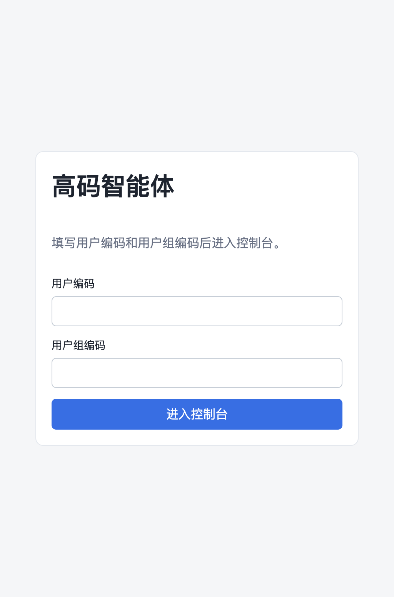
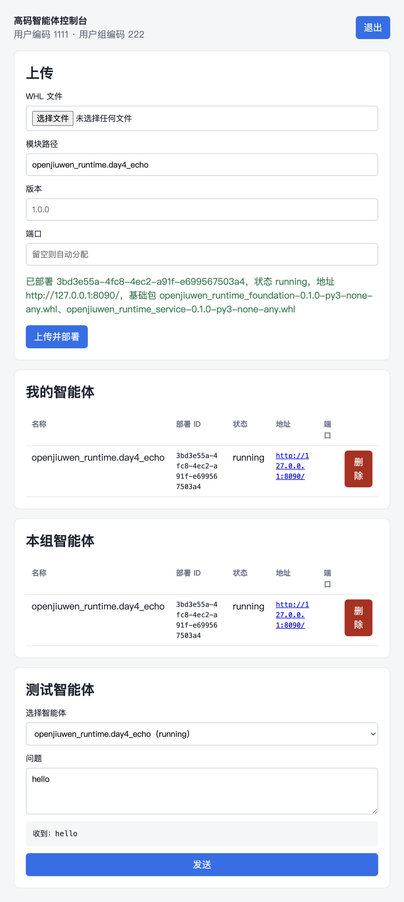

# 高码 Agent 运行时

这是我在 [openJiuwen Agent Runtime](https://github.com/openJiuwen/agent-runtime) 上做的二次开发。根目录的 `README.md` 和 `README_zh.md` 仍是官方说明，这里不改它们。

GitHub 仓库首页优先展示 `.github/README.md`，所以打开 [songhaowei666/agent-runtime](https://github.com/songhaowei666/agent-runtime) 时看到的是这一份。

## 我加了什么

高码 Agent 不走低码 `ir.json`。本地打成 WHL 后，上传到管理服务，由管理服务为每个部署建独立虚拟环境并拉起进程。

- 部署接口：`POST /api/v1/agents/deploy-whl`
- 转发接口：`POST /api/v1/agents/{deployment_id}/query`
  - 调用方只带部署 ID，管理服务按部署记录把请求体原样转到对应 Agent 的 `/query`，SSE 逐块返回
  - 控制台「测试智能体」走这个接口，浏览器不直连 Agent 端口
- 控制台：`http://<管理服务>:8186/highcode/login`
  - 登录页填写用户编码、用户组编码，分别作为 `user_id`、`space_id`
  - 控制台分开展示「我的智能体」和「本组智能体」
  - 可以上传 WHL、删除自己的部署，并在「测试智能体」里发一句对话
- 高码 Agent 源码放在 `highcode-agents/`，示例是 `highcode-agents/day4-echo`
- 自己打好的包放在 `highcode-whls/`，这个目录不会在启动时被清空

实现集中在 `server/openjiuwen_runtime/server/highcode_deploy.py` 和 `highcode-console/`。`server/openjiuwen_runtime/server/main.py` 只在末尾调用 `register_highcode(app, manager)`，方便以后把官方更新合并进来。

## 界面

登录页填写用户编码和用户组编码：



控制台可以上传 WHL，并查看、删除、测试已部署的智能体：



## 环境搭建（模拟内网离线）

按下面步骤从零构建管理服务环境。第三方依赖先下载到项目根目录 `wheels/`，再离线安装；本仓库源码用可编辑安装。更细的命令记录见 `内网部署/操作步骤.md`。

### 1. 创建虚拟环境

```bash
cd server
uv venv
source .venv/bin/activate
```

### 2. 外网下载第三方 WHL

```bash
cd ..
mkdir -p wheels
pip download -r requirements.txt -d wheels \
  -i https://pypi.tuna.tsinghua.edu.cn/simple \
  --trusted-host pypi.tuna.tsinghua.edu.cn
```

### 3. 离线安装第三方依赖

```bash
cd server
source .venv/bin/activate
uv pip install --no-index --find-links=../wheels -r ../requirements.txt
```

### 4. 可编辑安装本仓库包

仍在 `server` 目录、venv 已激活：

```bash
uv pip install --no-deps -e ../foundation
uv pip install --no-deps -e ../management
uv pip install --no-deps -e .
```

`--no-deps` 避免再次联网拉依赖。`foundation` / `management` / `server` 以可编辑方式挂到源码目录，改代码立刻生效。

### 5. 构建 foundation / service 基础 WHL

部署高码 Agent 时，管理服务会从 `dist/` 取这两个基础包装进部署虚拟环境，需先打好：

```bash
cd ../foundation
python -m build --wheel --outdir ../dist

cd ../service
python -m build --wheel --outdir ../dist
```

### 6. 启动管理服务

```bash
cd ../server
source .venv/bin/activate
set -a && source .env && set +a
python -m openjiuwen_runtime.server.main
```

当前配置是 `DEPLOY_TYPE=subprocess`、`MODE=dev`。高码 WHL 部署只在这两种配置下可用。

浏览器打开 `http://127.0.0.1:8186/highcode/login`。

控制台改过界面后需要重新构建：

```bash
cd highcode-console
npm run build
```

开发时也可以：

```bash
cd highcode-console
npm run dev
```

开发地址是 `http://127.0.0.1:5173/highcode/login`，接口会代理到 `8186`。

## 构建一个高码 Agent

高码 Agent 是一个能用 `python -m` 启动的 Python 包，不写 `ir.json`。部署时管理服务执行：

```bash
python -m <模块路径> --host 0.0.0.0 --port <端口>
```

模块路径必须对应包里带 `__main__.py` 的目录。示例在 `highcode-agents/day4-echo`，模块路径是 `openjiuwen_runtime.day4_echo`，目录如下：

```text
highcode-agents/day4-echo/
  pyproject.toml
  openjiuwen_runtime/
    day4_echo/
      __init__.py
      __main__.py
      day4_echo_runner.py
```

`pyproject.toml` 只写这个业务包自己的依赖。`foundation` 和 `service` 由管理服务部署时先装进该部署的虚拟环境，不要打进这个 WHL。包放在 `openjiuwen_runtime` 命名空间下，和基础包装在一起后，`python -m openjiuwen_runtime.day4_echo` 才能找到入口。高码 Agent 放在 `highcode-agents/`，不要放进 `applications/`。

`__main__.py` 取出 `AgentApp` 并调用 `app.run()`。`run()` 会读取 `--host` 和 `--port`。

业务逻辑写在 `AgentApp` 上。`day4_echo_runner.py` 的形状是：

```python
from openjiuwen_runtime.service.app.agent_app import AgentApp

app = AgentApp(
    app_name="day4_echo",
    app_description="Day4 高码回显 Agent",
    version="0.1.0",
)

@app.init
async def init():
    pass

@app.query
async def query(msgs, request, cancel_event=None):
    text = ""
    for msg in reversed(msgs or []):
        if msg.get("role") == "user":
            text = msg.get("content", "")
            break
    reply = f"收到：{text}"
    yield {"type": "text_delta", "content": reply}, False
    yield {"type": "result", "content": reply}, True

@app.shutdown
async def shutdown():
    pass
```

`@app.query` 是异步生成器，每次 `yield` 一个 `(消息, 是否结束)`。`text_delta` 是增量文本，最后一条把 `是否结束` 标成 `True`。`/query` 和 `/reset_conversation` 由 `AgentApp` 提供，管理服务的转发接口只把请求转到这里。

## 打包一个高码 Agent

以 `highcode-agents/day4-echo` 为例。模块路径是 `openjiuwen_runtime.day4_echo`。

`pyproject.toml` 的 `dependencies` 只写业务自己的第三方包，**不要**写入 `openjiuwen-runtime-foundation` / `openjiuwen-runtime-service`。这两个由管理服务部署时从 `dist/` 装进该部署的 venv。

```bash
cd server
source .venv/bin/activate

cd ../highcode-agents/day4-echo
python -m build --wheel --outdir ../../highcode-whls
```

在控制台上传 `highcode-whls/day4_echo_runner-0.1.0-py3-none-any.whl`，模块路径填 `openjiuwen_runtime.day4_echo`。

## 自测

`pyproject.toml` 的 `dependencies` 只保留业务包自己的库。`AgentApp` 来自 `service`，自测虚拟环境里单独安装本仓库的 `foundation` 和 `service`。这两次安装不写入 `pyproject.toml`，打出来的 WHL 也不依赖它们。

在 `highcode-agents/day4-echo` 建立虚拟环境并启动：

```bash
cd highcode-agents/day4-echo
uv venv
uv pip install -e ../../foundation -e ../../service -i https://pypi.tuna.tsinghua.edu.cn/simple
uv pip install -e . -i https://pypi.tuna.tsinghua.edu.cn/simple
.venv/bin/python -m openjiuwen_runtime.day4_echo --port 8090
```

另开一个终端，直接请求本机 Agent 的 `/query`。`conversation_id` 必填：

```bash
curl -N -X POST http://127.0.0.1:8090/query \
  -H 'Content-Type: application/json' \
  -d '{"messages":[{"role":"user","content":"hello"}],"conversation_id":"c1","user_id":"1111","space_id":"222","stream":true}'
```

`day4-echo` 会先返回一条 `text_delta`，再返回一条 `result`，内容都是 `收到：hello`。改 `day4_echo_runner.py` 后重启进程再发一次即可。`8090` 需是空闲端口。

部署后的自测不用再装 `service`。管理服务会先把 `dist/openjiuwen_*.whl` 装进 `deploys/{部署ID}/.venv`，再装业务 WHL。控制台「测试智能体」走 `POST /api/v1/agents/{deployment_id}/query`。用命令测时带上登录用的用户编码和用户组编码：

```bash
curl -N -X POST http://127.0.0.1:8186/api/v1/agents/<deployment_id>/query \
  -H 'Content-Type: application/json' \
  -H 'X-User-ID: 1111' \
  -H 'X-Space-ID: 222' \
  -d '{"messages":[{"role":"user","content":"hello"}],"conversation_id":"c1","user_id":"1111","space_id":"222","stream":true}'
```

回复应和本机那次一致。部署未就绪时返回 `409`，连不上 Agent 进程时返回 `502`。

## 和官方仓库的关系

- 官方远程是 `upstream`，只拉取
- 自己的 GitHub 是 `origin`，改动在 `dev` 上推送
- 官方文档见根目录 `README_zh.md`
